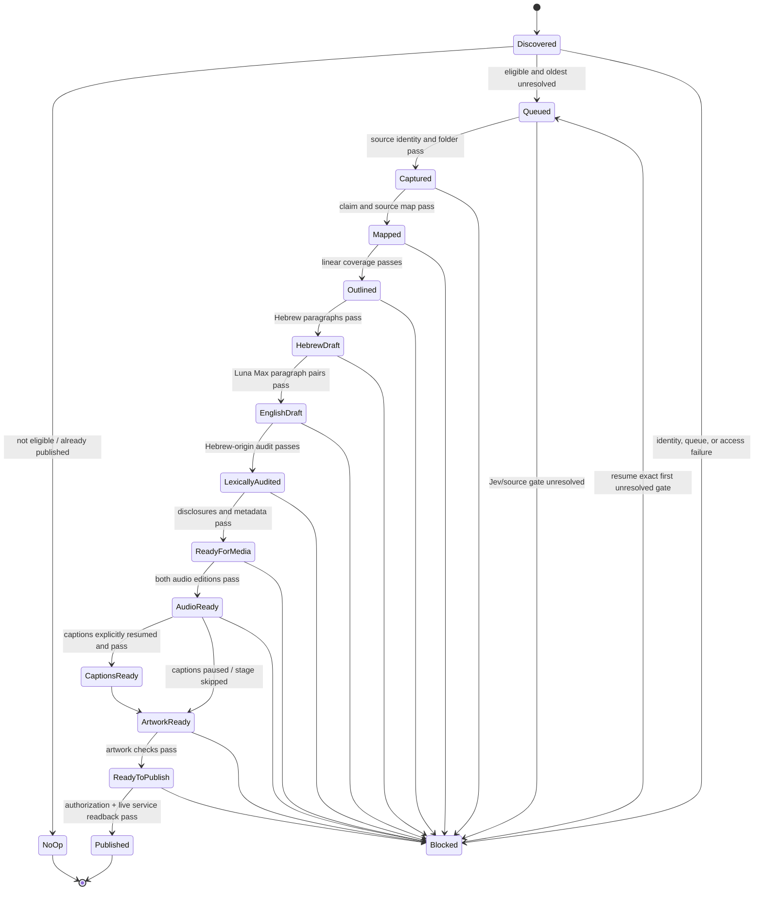

# Episode state machine

`Blocked` is resumable, not terminal: keep evidence, ledger status, and artifacts. A failed gate never advances the state. A no-op creates no episode artifacts. Do not mark `Published` from a local upload result or draft folder.
